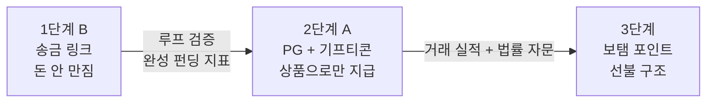
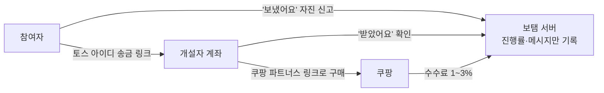
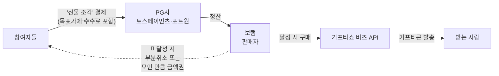

# 19. 결제 구조 · 선불 규제 · 준비 사항 (2026-10-07)

> 보탬의 결제 구조를 3단계로 정리하고, 포인트(선불) 구조로 갈 때의 규제와 지금부터 해야 할 준비를 모은 문서.
> 원본: Notion `보탬 Botem > PLAN > 기획팀 자료 > 보탬 결제 구조` · 관련: [05-정책결정서](../05-정책결정서.md) D-1·D-2·D-3·D-4, [10-제휴전략](../10-제휴전략.md), [11-기획허점리뷰](../11-기획허점리뷰.md), [18-브랜딩](18-브랜딩-디자인-결제구조.md)
> ⚠️ 규제 내용은 일반 정보이며 법률 자문이 아님. 구조 확정 전 전문가 확인 필수.

**한 줄 요약**: 지금은 돈을 만지지 않는 송금 링크(B)로 시작 → 거래 실적이 쌓이면 PG + 기프티콘(A) → 그 이후에만 보탬 포인트(선불) 검토. 사용자에게 보이는 말은 처음부터 끝까지 "3만 보탬 했어요"로 유지.

---

## 1. 전체 그림: 3단계

| 단계 | 돈 흐름 | 보탬이 돈을 만지나 | 필요한 등록·계약 | 수익 | 시점 |
|---|---|---|---|---|---|
| **1 · B (MVP)** | 참여자 → 개설자 계좌 직접 송금 (토스 아이디 송금 링크) | ❌ 안 만짐 | 사업자등록(권장), 쿠팡 파트너스 | 쿠팡 파트너스 1~3% | 지금 ~ 12/5 밋업데이 |
| **2 · A (확장)** | 참여자 → PG 결제 → 달성 시 기프티콘 발송 | 🟡 받지만 **상품으로만** 내보냄 | 사업자등록, 통신판매업 신고, PG 가맹, 기프티쇼 비즈 | 상품권 마진 + gross-up | B 루프 검증 후 |
| **3 · 보탬 포인트 (검토)** | 포인트 충전 → 펀딩에 사용 → 상품 교환 | 🔴 충전금 보관 | 선불업 등록 판단, 충전금 별도관리, 환불 정책 | 포인트 운용 + 상품 마진 | 거래 실적 확보 후 별도 결정 |

원칙: "가벼울수록 산다." 아래 단계로 갈수록 무거워진다. 다음 단계는 **지표가 증명했을 때만** 넘어간다.

### 사용자 언어는 그대로 ("보탬 = 동사" 브랜딩과 연결)

| 단계 | 사용자가 보는 말 |
|---|---|
| 송금 링크 | "3만 보탬 했어요" |
| PG + 기프티콘 | "3만 보탬 했어요" |
| 포인트 | "3만 보탬 했어요" / 잔액 12,000 보탬 |

브랜드 단위가 처음부터 '보탬'이면 결제 수단이 바뀌어도 UX를 다시 설계할 필요가 거의 없다 (토스머니, 배민페이머니 같은 방식).

---

## 2. 1단계 · B: 송금 링크 (MVP)

**왜 이 구조인가**: 보탬은 돈을 받지도, 보관하지도, 전달하지도 않는다 → 전자금융업 등록 이슈 없음. 모아줘가 이 구조로 생존 중, 프레제뉴는 무거운 구조로 종료.

| 리스크 | 내용 | 대응 |
|---|---|---|
| 송금 확인 불가 (P2) | 보탬은 실제 입금 여부를 모름 | '보냈어요' → 대기 → 개설자 '받았어요' → 확정. 진행률은 확정분만 |
| 미달성 처리 불가 (P3) | 돈이 이미 개설자 계좌에 있음 | "미달성 = 실패" 제거. 기한이 되면 모인 만큼 전달 |
| 사기·악용 (P5) | 허위 사연으로 계좌 수금 가능 | 링크 소지자만 공개(기본값), 신고 기능, 금칙어, 펀딩당 금액 상한 |
| 세금·기부금품법 (P7) | 계좌로 받는 돈은 이론상 증여 / 불특정 다수 모금 해석 여지 | 지인(링크 소지자)만 참여, FAQ에 "사회통념상 선물 수준" 안내, 금액 상한 가이드 |
| 수익 누수 (P6) | 개설자가 파트너스 링크로 안 살 수 있음 | 링크 구매 시 '선물 도착' 인증 + 참여자 완성 알림 + 감사 카드 보상 |
| 송금 링크 약관 | 토스·카카오페이 링크의 상업적 이용 가능 여부 미확인 | 약관 확인 후 개발 착수 |

---

## 3. 2단계 · A: PG 결제 + 기프티콘

> **핵심 원칙: 돈은 사람에게 가지 않고, 상품으로만 나간다.**
> 보탬이 참여자에게 '선물 조각(재화)'을 파는 판매자가 되는 구조. 모은 현금을 받는 사람에게 넘기는 순간 '정산·송금 대행'이 되어 전자금융업 규제로 들어간다.

### 이 단계의 규제
- **PG 정산 대행 규제** (2024-09 시행 개정 전자금융거래법): 결제대금을 받아 다른 판매자에게 나눠주는(재분배) 플랫폼은 PG 등록 또는 등록 PG에 정산 위탁 필요. 미등록 영업은 3년 이하 징역 또는 2천만 원 이하 벌금. → 보탬은 **직접 판매자(가맹점)**로 재분배 자체를 하지 않는 게 안전.
- **PG 정산자금 외부관리**: 2026-12부터 PG 등록 사업자는 정산자금 외부 관리 (첫해 60% → 3년 차 100%, 신탁·예치·지급보증보험). 보탬이 직접 PG가 될 이유 없음.
- **모바일상품권 = 선불전자지급수단**: 2024-09부터 대부분의 모바일상품권 포함. 발행 주체는 KT알파(기프티쇼) 등이고 보탬은 **유통·판매자** → 지위는 법률 자문으로 확인.
- **통신판매업 신고**: 재화 판매이므로 필요. 전자상거래법상 청약철회·환불 규정 적용.

### 정책 연결
- **gross-up (D-4 확정)**: 목표가에 수수료 포함, 참여자 부담, "수수료 포함" 투명 고지. 이 단계에서만 작동.
- **미달성 처리 (D-1)**: ① PG 부분취소 환불 ② 모인 만큼 금액권 기프티콘 중 선택. 환불 시 PG 수수료 부담 주체 결정 필요 (D-3).
- **실물 대리구매(A′)는 하지 않는다**: 배송·품절·반품·주소 수집 = 프레제뉴를 죽인 무게.

---

## 4. 3단계 · 보탬 포인트 (선불 구조)

> ⚠️ 포인트는 충전금을 보탬이 보관하는 구조라 법적 무게가 가장 크다. 머지포인트 사태(2021) 이후 규제가 크게 강화됐다. **지금 하지 않는다.** 대신 언어와 데이터를 미리 준비해 전환 비용을 줄인다.

### 왜 포인트를 고려하나
- 결제 수단이 바뀌어도 사용자의 말("3만 보탬")은 그대로 → 브랜드 단위 = 화폐 단위
- 잔액이 남으면 다음 펀딩·다른 친구 선물로 이어짐 → 재방문 이유 (저빈도 문제 해결)
- 참여·환불·잔액을 보탬이 직접 관리 → 진행률 신뢰 문제(P2) 완전 해소

### 포인트 옵션

| 옵션 | 내용 | 규제 무게 |
|---|---|---|
| **C-0. 무상 리워드 포인트** | 참여·초대 보상으로 보탬이 무료 지급 (충전 없음) | 낮음 — 대가를 받고 발행하지 않으면 일반적으로 선불수단과 성격이 다름. 마케팅 비용 처리 (확인 필요) |
| **C-1. 보탬 전용 충전 포인트** | 충전 포인트를 보탬이 파는 상품(기프티콘)에만 사용 | 중간 — 사용처가 발행자 1곳(동일 사업주)이면 등록 면제 범위에 들 가능성 (해석, 자문 필수) |
| **C-2. 범용 교환 포인트** | 여러 브랜드·가맹점에서 사용·교환 | 높음 — 선불전자지급수단 해당, 규모에 따라 선불업 등록 의무 |

### 선불전자지급수단 규제 핵심 (2024-09-15 시행 개정 전자금융거래법)

| 항목 | 내용 | 보탬에 주는 의미 |
|---|---|---|
| 적용 범위 확대 | 업종 기준(2개 이상) 폐지 → 1개 업종 상품권·쿠폰·포인트도 포함. 가맹점 면제 "10개 이하" → "1개(동일 사업주)만" | 여러 브랜드 상품 교환 시 거의 확실히 해당 |
| 등록 면제 기준 | 발행잔액 30억 원 미만 **그리고** 연간 총발행액 500억 원 미만 | 초기 규모는 면제 가능성 높음. 성장하면 바로 등록 의무 |
| 발행잔액 계산 | 직전 사업연도 1분기 ~ 신청 직전 분기 각 분기 말 미상환잔액의 단순평균 | 분기별 잔액을 지금부터 기록할 수 있게 원장 설계 |
| 선불충전금 보호 | 신탁·예치·지급보증보험으로 별도관리, 안전자산만 운용, 상계·압류·양도·담보 금지, 폐업 시 이용자 우선 지급. 금융위 "100% 보호" 발표 / 법률상 최소 50%로 정리한 자료도 있음 → **비율은 자문 시 확인** | 충전금은 운영비로 못 씀 → 현금흐름 이점 거의 없음 |
| 이용자 정보 보호 | 잔액 정보 원격지 백업, 거래 내역 기록·보관 | 포인트 원장·백업 인프라 필요 |
| 미등록 영업 | 형사처벌. 기존 사업자는 시행 후 6개월 내 등록 의무였음 | "일단 하고 나중에 등록" 불가 |

### 환불 기준 (참고)
- 공정위 신유형 상품권 표준약관: 1만 원 초과 60% 이상, 1만 원 이하 80% 이상 사용 시 잔액 환불. 유효기간 경과 후에도 구매액의 90% 환불.
- 포인트 도입 시 이에 준하는 환불·유효기간 정책을 약관에 명시 (적용 여부는 자문 확인).

### 원칙 충돌 체크
포인트화는 원칙 1번 "가벼울수록 산다 — 돈을 깊게 만지는 방향으로는 확장하지 않는다"와 정면 충돌. 프레제뉴 사례. → **언어는 지금부터 '보탬' 단위로 깔고, 포인트는 거래 실적 + 법률 자문 이후에만.**

---

## 5. 앞으로 해야 할 일 · 대비 · 준비물

### 지금 당장 (개발 기간 10/12 ~ 11/27 중)
- [ ] **사업자등록** — 기프티쇼 비즈·PG·쿠팡 파트너스 API의 선행 조건
- [ ] 토스 아이디 송금 링크 / 카카오페이 딥링크 상업적 이용 약관 확인
- [ ] 쿠팡 파트너스 약관: 타인 자금으로 본인 수령 구매 시 자가구매 제한, 대가성 고지 의무
- [ ] 이용약관·개인정보처리방침 초안 (참여자 이름·메시지 수집 범위)
- [ ] FAQ: 증여·기부금품법 안내, 펀딩당 금액 상한 가이드
- [ ] 신고 기능 + 링크 소지자만 공개 기본값 (P5)
- [ ] UI 카피·공유 카드·푸시를 "○만 보탬" 단위로 통일

### 개발 설계에서 미리 대비 (전환 비용을 줄이는 장치)
- [ ] **참여 원장(ledger) 테이블**: 참여 1건 = 1행 (참여자, 금액, 상태: 대기/확정/취소, 시각, 결제수단). 지금은 결제수단=송금, 나중엔 PG·포인트로 값만 바뀌게
- [ ] 금액 상태 3단계(대기·확정·취소)를 처음부터 모델링 → A단계 부분취소, 포인트 환불에 그대로 사용
- [ ] 결제 모듈 인터페이스 분리 (송금 링크 / PG / 포인트 교체 가능). "결제 시스템은 테스트 모드로 끝까지 만들어 두고, 실적이 쌓이면 켠다"와 연결
- [ ] 분기별 집계 가능한 로그 (향후 발행잔액·연간 발행액 계산 근거)

### 2단계(A) 진입 전
- [ ] **법률 자문 1회** (D-3, 아래 질문 리스트)
- [ ] 통신판매업 신고
- [ ] PG 가맹 계약 (토스페이먼츠·포트원 비교: 수수료, 부분취소, 정산 주기)
- [ ] 기프티쇼 비즈 가입 → 카탈로그·단가·API·금액권 지원 여부
- [ ] 미달성 정책 확정 (부분취소 vs 모인 만큼 금액권) + 환불 시 PG 수수료 부담 주체
- [ ] gross-up 고지 UI (상품가 / 수수료 내역)
- [ ] **진입 조건(지표)** 팀 합의: 예) 월 완성 펀딩 수, 링크 받은 친구 참여율 50% 이상, 참여자→개설자 전환율

### 3단계(포인트) 검토 전
- [ ] 예상 발행잔액·연간 발행액 시뮬레이션 → 면제 구간(30억/500억) 안에서 운영 가능한지
- [ ] 옵션 결정: C-0(무상 리워드)부터 시작할지, C-1(보탬 전용)까지 갈지
- [ ] 충전금 별도관리 방식 (신탁 / 은행 예치 / 지급보증보험) 견적
- [ ] 환불·유효기간 정책, 잔액 백업 인프라
- [ ] 상표 확보: 보탬 / Botem (KIPRIS 35·36·42류)

---

## 6. 법률 자문 질문 리스트 (D-3)

1. B 구조(참여자→개설자 직접 송금, 보탬은 진행률만 표시)에서 보탬에 전자금융업 등록 의무가 생길 여지가 있는가?
2. 송금 링크(토스 아이디 등)를 서비스 내에서 연결·안내하는 행위가 결제대행이나 송금 중개로 해석될 수 있는가?
3. A 구조에서 보탬이 '선물 조각'을 직접 판매하고 달성 시 기프티콘을 발송하면, 재분배(정산 대행) 없이 일반 통신판매로 볼 수 있는가?
4. 미달성 시 '모인 만큼 금액권 기프티콘 지급'은 상품 판매인가, 사실상 현금 전달인가?
5. 기프티쇼 비즈로 구매한 모바일상품권을 유통할 때 보탬에 선불업 관련 의무가 생기는가?
6. 보탬 전용 충전 포인트(사용처: 보탬이 판매하는 상품만)는 '가맹점 1개(동일 사업주)' 면제에 해당하는가?
7. 무상 리워드 포인트(충전 없음)는 선불전자지급수단에서 제외되는가?
8. 증여·기부금품법 관련 펀딩당 금액 상한 등 안전장치 권고 수준은?

---

## 7. 미결정 항목

| 항목 | 연결 문서 | 상태 |
|---|---|---|
| D-1 미달성 처리 (B: 모인 만큼 전달 / A: 부분취소 vs 금액권) | 05, 11 P3 | ⬜ |
| D-3 자금 처리·규제 (법률 자문) | 05 | ⬜ 🔴 최우선 |
| A단계 진입 지표 수치 | 12 | ⬜ |
| 포인트 옵션 (C-0 / C-1 / C-2) | 이 문서 | ⬜ 실적 확보 후 |
| 단위 표기 규칙 ("3만 보탬" / "30,000원") | 18 | 🟡 제안 |

---

## 출처
- 서울파이낸스 · 선불업, 연간 500억 미만 발행 시 등록 의무 면제: https://www.seoulfn.com/news/articleView.html?idxno=523849
- 플래텀 · 2024년 9월부터 선불전자지급수단 등록 의무 확대: https://platum.kr/archives/217353
- 법무법인 대륜 · 전금법 개정안 시행: https://www.daeryunlaw.com/newsletter/news/62
- 금융위원회 · 선불충전금 100% 보호: https://www.fsc.go.kr/no010101/83004
- 토스페이먼츠 · 전자금융거래법 개정 대비: https://www.tosspayments.com/blog/articles/amendment
- 에이핀 · 플랫폼이 돈을 잠깐 보관하면 전자금융업 등록이 필요한가요: https://a-fin.co.kr/insights/platform-fund-custody-escrow
- 아주경제 · 신유형상품권 표준약관: https://www.ajunews.com/view/20150402140234893
