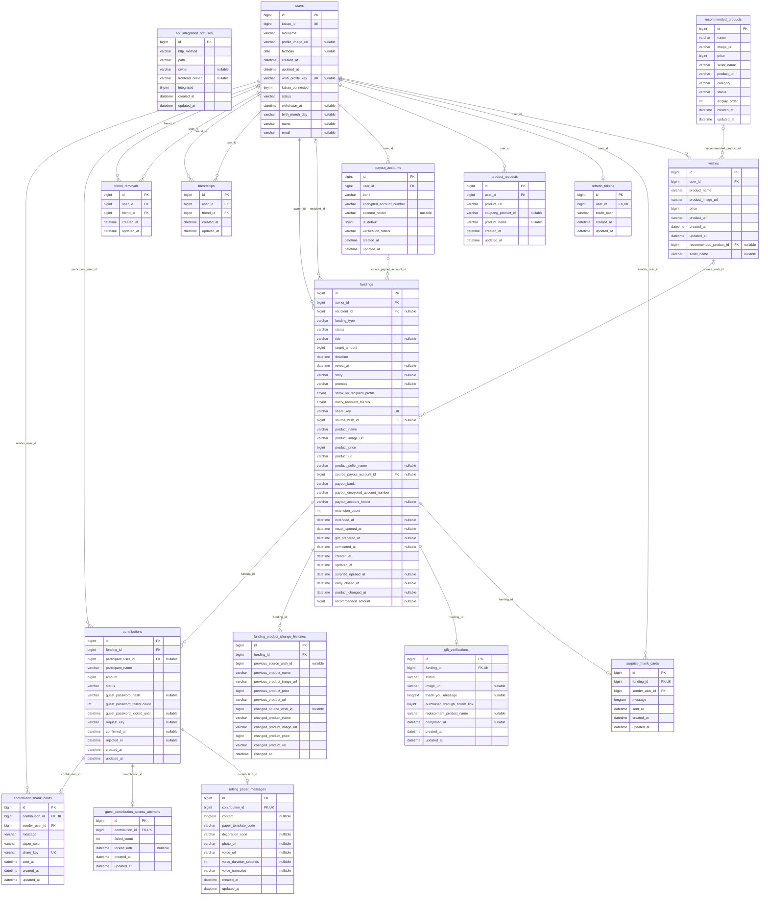

# BOTEM-BE

BOTEM 백엔드 서버입니다.

- 📐 [아키텍처와 기술 선택 이유](docs/architecture.md): 시스템·배포 구조, 주요 기술을 고른 이유와 해결한 문제, 확장 계획
- 📈 [부하 테스트 결과](loadtest/README.md): 핵심 API 처리량, 동시 보태기 정합성, 쿼리 실행계획

# 🛠️ Tech Stack

### 💻 Language & Framework

- **Language** `Kotlin`
- **JDK** `Java 21`
- **Framework** `Spring Boot 4.1`
- **Web** `Spring Web MVC`

### 🔐 Security

- **Authentication & Authorization** `Spring Security`
- **Token** `JWT`

### 🗄️ Database & Persistence

- **RDBMS** `MySQL`
- **ORM** `Spring Data JPA`
- **Database Migration** `Flyway`

### ☁️ Infrastructure & Storage

- **Cloud Platform** `AWS`
- **Compute** `EC2`
- **Database** `RDS`
- **Object Storage** `S3`
- **Container Registry** `ECR`

### 🚀 CI/CD

- **CI/CD Pipeline** `GitHub Actions`
- **Containerization** `Docker`

### 📚 API Documentation

- **API Specification** `Springdoc OpenAPI`
- **API Documentation UI** `Swagger UI`

### 🧪 Testing & Code Quality

- **Testing** `JUnit 5` · `Spring Test` · `Testcontainers (MySQL)`
- **Load Testing** `k6`
- **Code Coverage** `Kover`
- **Automated Code Review** `CodeRabbit`

### 📊 Monitoring

- **Error Tracking** `Sentry`
- **Metrics Collection** `Prometheus` (도입 예정, #205)
- **Monitoring & Visualization** `Grafana` (도입 예정, #205)

# 🗂️ ERD

실제 MySQL에 Flyway 마이그레이션을 적용한 스키마로 자동 생성합니다. 직접 수정하지 말고 `./gradlew generateErd`(Docker 필요)로 갱신하세요. 엔티티·마이그레이션이 바뀐 PR에서는 CI가 자동으로 갱신해 커밋합니다.

<!-- ERD:START -->

<!-- ERD:END -->

# 🌿 Git Convention

## 1. Branch Strategy

Git Flow 전략을 기반으로 브랜치를 관리

### 브랜치 종류

| 브랜치 | 설명 | 분기 기준 | 병합 대상 |
| --- | --- | --- | --- |
| `main` | 운영 환경 배포 | - | - |
| `develop` | 개발 기능 통합 | `main`에서 최초 생성 | `main` |
| `feat` | 새로운 기능 개발 | `develop` | `develop` |
| `fix` | 개발 중 발생한 버그 수정 | `develop` | `develop` |
| `refactor` | 기존 코드 리팩토링 | `develop` | `develop` |
| `docs` | 문서 작성 및 수정 | `develop` | `develop` |
| `test` | 테스트 코드 추가 및 수정 | `develop` | `develop` |
| `chore` | 빌드, 설정 및 기타 변경 | `develop` | `develop` |
| `hotfix` | 운영 환경 긴급 오류 수정 | `main` | `main`, `develop` |

### 브랜치 네이밍

`{type}/#{issue-number}-{description}`

```
feat/#12-user-signup
fix/#34-token-validation
refactor/#45-user-service
hotfix/#56-login-error
```

- 브랜치 이름은 영문 소문자를 사용합니다.
- 단어 구분은 하이픈(-)을 사용합니다.
- GitHub Issue 번호를 포함합니다.
- 하나의 브랜치는 하나의 Issue를 기준으로 생성합니다.

### 브랜치 운영 규칙

1. 모든 기능 개발은 `develop`에서 브랜치를 생성합니다.
2. 개발 완료 후 `develop`을 대상으로 PR을 생성합니다.
3. `develop`에서 기능 통합 및 테스트를 진행합니다.
4. 배포 시 `develop`의 검증된 변경 사항을 `main`에 병합합니다.
5. 운영 환경 긴급 수정은 `main`에서 `hotfix` 브랜치를 생성합니다.
6. `hotfix` 수정 사항은 `main`과 `develop` 모두에 반영합니다.
7. `main`, `develop`에 직접 Push하지 않고 PR을 통해 병합합니다.

---

## 2. Pull Request & Merge Strategy

### PR 운영 규칙

- 모든 코드 변경은 PR을 통해 병합합니다.
- PR에는 관련 Issue를 연결합니다.
- PR 생성 시 CodeRabbit 자동 리뷰를 진행합니다.
- CodeRabbit의 리뷰 내용을 확인하고 필요한 사항을 수정합니다.
- 팀원 Approve는 필수로 요구하지 않습니다.
- CI 빌드 및 테스트가 성공해야 병합할 수 있습니다.
- PR 병합 완료 후 작업 브랜치를 삭제합니다.

### Merge Strategy

**Create a merge commit 사용**

- Squash Merge를 사용하지 않습니다.
- Rebase Merge를 사용하지 않습니다.
- 기능 브랜치의 개별 커밋 이력을 유지합니다.
- PR 병합 시 Merge Commit을 생성합니다.

### Code Review

CodeRabbit을 활용하여 자동 코드 리뷰를 진행합니다.

**검토 항목**

- 잠재적인 버그 및 예외 처리 누락
- 보안 취약점
- 성능 문제
- 코드 중복 및 가독성
- 코드 컨벤션 준수 여부

**리뷰 운영 기준**

- CodeRabbit의 모든 제안을 반드시 반영할 필요는 없습니다.
- 버그, 보안, 데이터 정합성 관련 지적은 우선 검토합니다.
- 리뷰 결과에 대한 최종 판단은 PR 작성자가 수행합니다.
- 사람의 Approve 없이도 병합할 수 있습니다.
