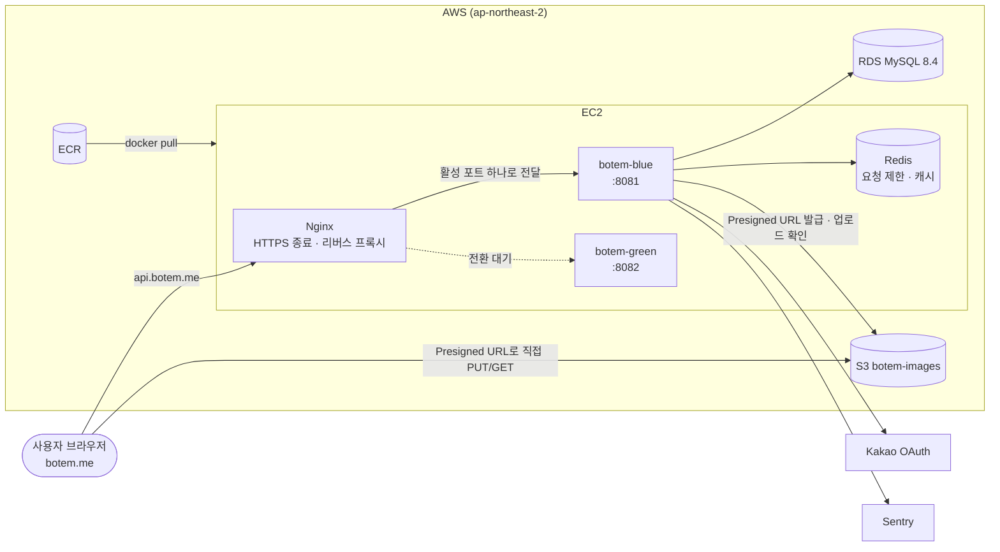
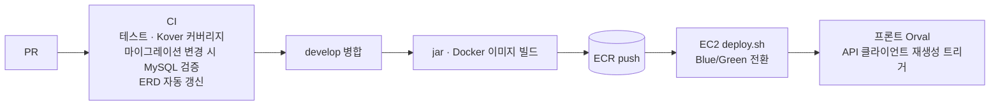

# 아키텍처와 기술 선택

BOTEM 백엔드의 시스템 구조, 주요 기술을 고른 이유와 그 기술로 해결한 문제, 확장 계획을 정리한다.
데이터 구조는 [README](../README.md)의 ERD 섹션을 참고한다 (엔티티나 마이그레이션이 바뀐 PR에서 CI가 자동 갱신).

## 1. 시스템 구조



| 구성 요소 | 역할 |
|---|---|
| Nginx | HTTPS 종료(Certbot), `/actuator` 외부 차단, 활성 컨테이너로 프록시, `X-Real-IP` 전달 |
| Spring Boot 컨테이너 | Blue(8081)/Green(8082) 중 하나만 활성. `127.0.0.1`에만 바인딩해 Nginx를 거쳐야만 접근 가능 |
| RDS MySQL | EC2 보안 그룹에서 오는 3306만 허용 |
| Redis | 요청 횟수 제한 카운터와 사용자 상태 캐시. 앱 컨테이너와 같은 Docker 내부 네트워크에만 열고 디스크에 저장하지 않는다 |
| S3 | 상품·프로필 이미지, 롤링페이퍼 사진·음성, 선물 인증 사진. EC2 IAM Role로 접근 |
| Sentry | 에러 수집. 모든 로그와 이벤트에 요청 ID(`X-Request-Id`)를 붙여 추적 |

### 패키지 구조

```
com.botem
├── domain        # 기능 단위: auth, user, wish, product, funding, home, friend, account, apiboard
│   └── <도메인>   # controller(+docs) · service · repository · entity · dto · exception
└── global        # 공통: config, security, jwt, exception, response, logging, ratelimit, property
```

Controller는 요청 검증과 응답 변환, Service는 비즈니스 흐름, Entity는 상태 변경 규칙을 맡는다.
Swagger 설명은 `*ControllerDocs` 인터페이스로 분리해 Controller 코드를 짧게 유지한다.

## 2. 배포 파이프라인



- **무중단 배포**: 대기 중인 색으로 새 컨테이너를 띄우고 `/actuator/health`가 UP이 된 뒤에만 Nginx upstream을 바꾼다.
  헬스 체크나 Nginx 전환이 실패하면 기존 컨테이너를 그대로 두고 새 컨테이너만 지운다.
  전환 후에는 기존 연결이 끝나도록 기다린 뒤 이전 컨테이너를 graceful shutdown(30초)으로 내린다.
- **장기 키 없는 AWS 인증**: GitHub OIDC로 IAM Role을 맡아 실행마다 임시 자격 증명을 받는다. 신뢰 정책은 `develop` 브랜치만 허용한다.
- **SSH 최소 개방**: EC2의 22번 포트는 평소 닫혀 있고, 배포 중에만 러너 IP를 보안 그룹에 추가했다가 성공·실패와 관계없이 제거한다.
- **시크릿 주입**: 운영 설정은 모두 GitHub Secrets → `.env`(권한 600) → 컨테이너 환경 변수로 전달한다. 저장소에는 시크릿이 없다.

## 3. 기술 선택 이유와 해결한 문제

### 동시 보태기: 펀딩 행 비관적 락

- **문제**: 여러 사람이 같은 펀딩에 동시에 보태면 "남은 금액 확인 → 저장" 사이에 다른 요청이 끼어들어 목표 금액을 넘기거나, 같은 이름의 비회원이 중복 등록될 수 있다.
- **선택**: 보태기·입금 확인처럼 펀딩 금액에 영향을 주는 쓰기는 `SELECT ... FOR UPDATE`로 펀딩 행을 먼저 잠근다 (`findByIdForUpdate`).
  같은 펀딩의 쓰기만 직렬화되고 다른 펀딩은 서로 막지 않는다.
- **낙관적 락을 쓰지 않은 이유**: 인기 펀딩에 요청이 몰리는 상황이 핵심 시나리오라 충돌이 잦다. 낙관적 락은 충돌마다 재시도가 필요해, 대기 후 순서대로 처리하는 편이 단순하다.
- **락 점유 시간 줄이기**: 입력 정규화, 비밀번호 해시, S3 업로드 확인처럼 느린 작업은 락을 잡기 전에 끝낸다.
- **검증**: 100명이 같은 펀딩에 동시에 보태는 부하 테스트에서 금액·건수 유실이 없고, 같은 이름 50건 동시 요청 중 1건만 저장됐다 ([부하 테스트 결과](../loadtest/README.md)).
- **중복 요청 방지**: 클라이언트가 보내는 `requestKey`에 `(funding_id, request_key)` 유니크 제약을 걸어, 네트워크 재시도로 같은 보탬이 두 번 저장되지 않게 한다.

### 공유 링크: 추측할 수 없는 공유 키

- **문제**: 공유 화면 URL에 순차 ID(`/fundings/12`)를 쓰면 숫자만 바꿔 다른 사람의 펀딩을 열람할 수 있다.
- **선택**: 펀딩마다 128비트 난수(32자리 16진수) `share_key`를 두고, 비로그인 참여 API는 모두 `/api/fundings/share/{shareKey}` 경로로 받는다. 개설자 전용 API는 로그인 사용자 확인 후 ID로 접근한다.
- **무중단 배포 호환**: 컬럼을 추가할 때 DB 기본값을 `(LOWER(HEX(RANDOM_BYTES(16))))`로 두어, 전환 중인 이전 버전 서버가 share_key 없이 저장해도 실패하지 않게 했다.

### 파일 업로드: S3 Presigned URL

- **문제**: 사진·음성을 서버로 받으면 대용량 바이트가 애플리케이션 메모리와 대역폭을 차지한다.
- **선택**: 서버는 용도별 경로(`rolling-paper/`, `gift-verification/`, `profile/`)로 제한한 Presigned PUT URL만 발급하고, 브라우저가 S3에 직접 올린다.
- **신뢰하지 않기**: URL 발급 시 용도별 크기 제한을 서명에 포함하고, 저장 요청이 오면 서버가 S3에서 객체가 실제로 올라왔는지 확인한다.
  롤링페이퍼 사진·음성은 파일 앞부분의 시그니처로 실제 형식(JPEG/PNG/WebP, MP4/MP3/WebM/Ogg 음성)까지 검사한다. 클라이언트가 보낸 URL과 확장자를 그대로 믿지 않는다.
- **장애 격리**: S3 호출에는 시도당 2초, 전체 5초 타임아웃을 둬서 S3가 느려져도 요청 스레드가 묶이지 않게 했다.

### 스키마 관리: Flyway + 실제 MySQL 검증

- **선택**: 모든 스키마 변경을 Flyway 마이그레이션으로 관리하고, JPA는 `ddl-auto: validate`로 엔티티와 스키마가 일치하는지만 확인한다.
- **H2 테스트의 빈틈 메우기**: 일반 테스트는 빠른 H2로 돌리지만, MySQL 전용 문법(표현식 기본값, CHECK 제약, 네이티브 쿼리)은 H2에서 검증되지 않는다.
  그래서 마이그레이션 관련 파일이 바뀐 PR에서만 Testcontainers MySQL 8.4로 전체 마이그레이션과 엔티티 매핑을 검증한다.
- **무중단 배포 규칙**: Blue/Green 전환 중에는 이전 버전이 새 스키마로 동작하므로, 컬럼 삭제·이름 변경은 "추가 → 코드 전환 → 다음 배포에서 삭제"로 나눈다.

### 펀딩 데이터 보존: 스냅샷

- **문제**: 펀딩이 위시 상품과 정산 계좌를 참조만 하면, 개설 후 위시를 지우거나 계좌를 바꿨을 때 진행 중인 펀딩 정보가 바뀐다.
- **선택**: 개설 시점의 상품(이름·이미지·가격·판매처)과 정산 계좌를 펀딩 테이블에 임베디드 스냅샷으로 복사한다. 원본 ID는 추적용으로만 남기고 삭제되면 `NULL`이 된다.
  개설자가 상품을 바꾸면 변경 이력을 별도 테이블에 남긴다.

### 인증과 민감 정보

- **JWT + 회전하는 리프레시 토큰**: 액세스 토큰은 무상태로 검증하고, 리프레시 토큰은 HttpOnly 쿠키로 전달한다. DB에는 해시만 저장하고 재발급할 때마다 교체한다.
- **계좌번호 암호화**: 정산 계좌번호는 AES-GCM으로 암호화해 저장하고, 송금 안내가 필요한 응답에서만 복호화한다.
- **비회원 비밀번호**: 비회원 보탬의 수정·취소용 4자리 비밀번호는 BCrypt 해시로 저장하고, 연속 실패 시 잠근다.
- **요청 횟수 제한**: 비로그인으로 호출할 수 있는 보태기·업로드 URL 발급·비회원 인증 API는 IP당 분당 요청 수를 제한하고, 초과하면 `429`와 `Retry-After`를 응답한다.

### 요청 횟수 제한과 캐시: Redis

- **문제**: 요청 횟수 제한을 서버 메모리에 세면 서버를 늘렸을 때 서버마다 따로 세어 한도가 대수만큼 풀린다.
  또 인증된 요청마다 회원 상태를 DB에서 조회해, 혼합 부하에서 이 한 문장이 약 22만 번 실행됐다 ([부하 테스트](../loadtest/README.md)).
- **선택**: 카운터를 Redis `INCR` + 만료로 옮기고, 회원 상태 조회에 Spring 캐시(Redis, TTL 5분)를 붙였다.
  상태는 활성 → 탈퇴로만 바뀌므로 활성만 캐시하고, 탈퇴가 커밋되면 지운다.
- **장애 격리**: Redis 명령은 200ms 안에 끝나지 않으면 실패로 본다. 실패하면 요청 제한은 통과, 캐시는 DB 조회로 대신해 Redis 장애가 서비스 장애로 번지지 않는다.
  같은 이유로 배포 헬스 체크는 Redis 상태를 보지 않는다.
- **비용**: 지금은 서버가 한 대라 같은 EC2에 Redis 컨테이너를 둬 추가 비용이 없다. 서버를 여러 대로 늘릴 때 ElastiCache로 옮기고 `REDIS_HOST`만 바꾼다.

### 운영 관측

- **요청 추적**: 요청마다 ID를 발급해 로그(MDC), 응답 헤더 `X-Request-Id`, Sentry 태그에 같은 값을 남긴다. 프론트가 오류를 전달할 때 이 값으로 서버 로그와 Sentry 이벤트를 바로 찾는다.
- **지연 로딩 범위 제한**: `open-in-view: false`로 트랜잭션 밖에서 지연 로딩 쿼리가 실행되지 않게 해, 커넥션 점유가 응답 직렬화까지 늘어나지 않게 했다.
- **외부 호출 타임아웃**: 카카오 등 HTTP 클라이언트는 연결 3초, 응답 5초로 제한한다.

## 4. 확장 계획

현재는 단일 EC2와 단일 RDS로 운영한다. 트래픽이 늘면 아래 순서로 확장한다.

| 단계 | 내용 | 지금 구조에서 준비된 점 / 바꿔야 할 점 |
|---|---|---|
| 수평 확장 | ALB + Auto Scaling 그룹으로 인스턴스를 여러 대 운영하고, Blue/Green은 ALB 대상 그룹 전환으로 바꾼다 | 세션이 없고 JWT·DB 기반이라 앱은 무상태다. 요청 횟수 제한과 캐시도 Redis에 있어 서버 간에 공유된다. Redis를 EC2 컨테이너에서 ElastiCache로 옮기면 된다 |
| 쓰기 처리량 | 보태기의 병목은 펀딩 락이 아니라 비회원 비밀번호 BCrypt 해시(CPU)였다 | 해시 계산을 트랜잭션 밖으로 옮겨 DB 커넥션 점유 시간을 줄이고, CPU 코어가 많은 인스턴스나 인스턴스 수로 대응한다 |
| 읽기 부하 | 펀딩 상세·홈 조회는 RDS 읽기 전용 복제본으로 분리한다 | 조회 서비스는 `@Transactional(readOnly = true)`로 구분돼 있어 라우팅 데이터소스로 나누기 쉽다 |
| 비동기 처리 | 알림(#160)처럼 응답에 필요 없는 작업은 트랜잭션 커밋 후 이벤트로 분리하고, 유실되면 안 되는 작업은 아웃박스 테이블 + 큐(SQS)로 처리한다 | 현재는 비동기 작업이 없어 모든 처리가 요청 안에서 끝난다 |
| 장애 격리 | 외부 연동(S3, 카카오)이 느려져도 전체 스레드가 묶이지 않게 한다 | 타임아웃은 적용돼 있다. 호출량이 늘면 서킷 브레이커(Resilience4j)를 추가한다 |
| 관측 | Prometheus·Grafana로 요청 지연, 커넥션 풀, JVM 지표를 수집한다 (#205) | Sentry와 요청 ID 기반 로그 추적은 적용돼 있다 |

### 도입하지 않은 기술

| 기술 | 도입하지 않은 이유 | 도입할 시점 |
|---|---|---|
| Kubernetes | 서비스가 하나고 Blue/Green 무중단 배포와 컨테이너 재시작으로 충분하다. 클러스터 운영 비용과 복잡도가 서비스 규모보다 크다 | 서비스가 여러 개로 나뉘거나 인스턴스 수가 자주 바뀔 때 (먼저 ALB + Auto Scaling) |
| Streaming (SSE·WebSocket) | 실시간으로 밀어 줄 화면이 없다. 펀딩 진행률은 화면을 열 때 조회하면 충분하다 | 알림(#160) 등 즉시 전달이 필요한 기능이 확정될 때 |
| AI·LLM | 서비스 핵심 흐름(위시 → 펀딩 → 보태기 → 선물)에 필요한 곳이 아직 없다 | 상품 추천·메시지 작성 보조 등 기획이 확정될 때 |
