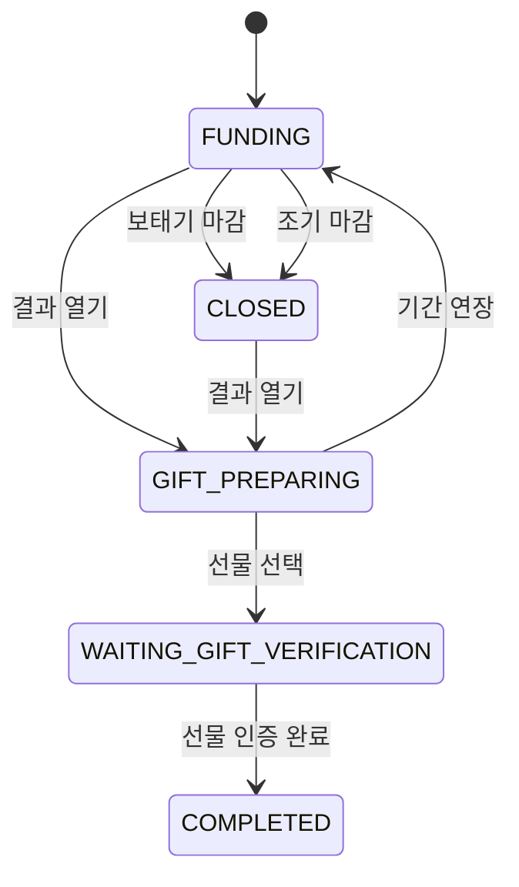
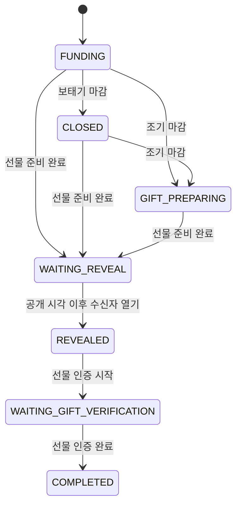

# 펀딩 상태 전이 정책

일반 펀딩과 서프라이즈 펀딩은 서로 다른 후속 절차를 가진다. 이 문서는 `Funding` 엔티티의 상태 전이와 각 전이에 필요한 도메인 선행 조건을 정의한다.

상태 변경의 책임은 `Funding`에 둔다. 서비스는 확정 금액, 입금 확인 대기 보탬, 권한처럼 저장소 조회가 필요한 사실을 확인한 뒤 `Funding`의 행위를 호출한다.

## 상태 정의

| 상태 | 의미 |
| --- | --- |
| `FUNDING` | 보태기 진행 중 |
| `CLOSED` | 금액 보태기는 마감됐고, 마감일 전까지 메시지 참여는 가능 |
| `GIFT_PREPARING` | 선물을 고르거나 준비하는 단계 |
| `WAITING_REVEAL` | 서프라이즈 선물 준비가 끝났고 공개 시각을 기다리는 단계 |
| `REVEALED` | 수신자에게 공개된 서프라이즈 |
| `WAITING_GIFT_VERIFICATION` | 선물 인증을 기다리는 단계 |
| `COMPLETED` | 선물 인증까지 완료된 종료 상태 |
| `CANCELLED` | 취소된 종료 상태. 현재는 생성·전이 API가 없으며 진행 중 상태로 되돌릴 수 없다. |

## 일반 펀딩 전이

| 현재 상태 | 행위 | 다음 상태 | 선행 조건 |
| --- | --- | --- | --- |
| `FUNDING` | `closeContributions` | `CLOSED` | 마감일 경과 또는 목표 금액 도달 여부는 호출 서비스가 판단 |
| `FUNDING`, `CLOSED` | `closeEarly` | `CLOSED` | 마감일 전, 조기 마감 이력 없음 |
| `FUNDING`, `CLOSED` | `openResult` | `GIFT_PREPARING` | 마감 후 또는 목표 달성·확인 대기 보탬 없음으로 조기 결과 열기 가능 |
| `GIFT_PREPARING` | `chooseGift` | `WAITING_GIFT_VERIFICATION` | 결과가 열린 일반 펀딩 |
| `WAITING_GIFT_VERIFICATION` | `completeGiftVerification` | `COMPLETED` | 선물 인증이 완료됨 |
| `FUNDING`, `CLOSED`, `GIFT_PREPARING` | `extendDeadline` | `FUNDING` | 일반 펀딩, 조기 마감 전, 마감 후, 1회 미만 연장, 목표 미달. `GIFT_PREPARING`은 결과를 이미 연 경우만 허용 |

`openResult`, `chooseGift`, `completeGiftVerification`은 이미 완료된 동일 요청을 멱등하게 처리한다.

## 서프라이즈 펀딩 전이

| 현재 상태 | 행위 | 다음 상태 | 선행 조건 |
| --- | --- | --- | --- |
| `FUNDING` | `closeContributions` | `CLOSED` | 마감일 경과 또는 목표 금액 도달 여부는 호출 서비스가 판단 |
| `FUNDING`, `CLOSED` | `closeEarly` | `GIFT_PREPARING` | 마감일 전, 조기 마감 이력 없음 |
| `FUNDING`, `CLOSED`, `GIFT_PREPARING` | `prepareSurpriseGift` | `WAITING_REVEAL` | 서프라이즈, 금액 보태기 마감, 선물 준비 완료 |
| `WAITING_REVEAL` | `revealSurprise` | `REVEALED` | 수신자 본인, 공개 시각 도달, 선물 준비 완료 |
| `REVEALED` | `beginGiftVerification` | `WAITING_GIFT_VERIFICATION` | 서프라이즈 공개 완료 |
| `WAITING_GIFT_VERIFICATION` | `completeGiftVerification` | `COMPLETED` | 선물 인증이 완료됨 |

`prepareSurpriseGift`, `revealSurprise`, `beginGiftVerification`, `completeGiftVerification`은 이미 완료된 동일 요청을 멱등하게 처리한다.

## 공통 원칙

- 펀딩 유형과 현재 상태가 맞지 않는 전이는 `FundingErrorCode`로 거부한다.
- 시간·금액·입금 확인 대기 보탬처럼 조회가 필요한 조건은 서비스가 확인하고, 엔티티는 전이 가능한 상태인지 최종 검증한다.
- 상태를 바꾸는 새 기능은 이 문서의 전이표와 엔티티 전이 매트릭스 테스트를 함께 갱신한다.
- 상태 이력 감사 로그는 별도 이슈에서 다룬다. 이번 리팩터링은 기존 전이 동작을 보존하는 데 집중한다.
